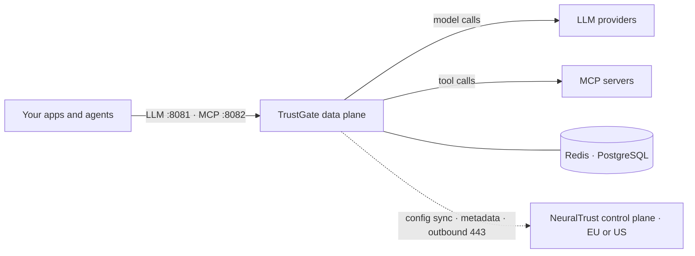
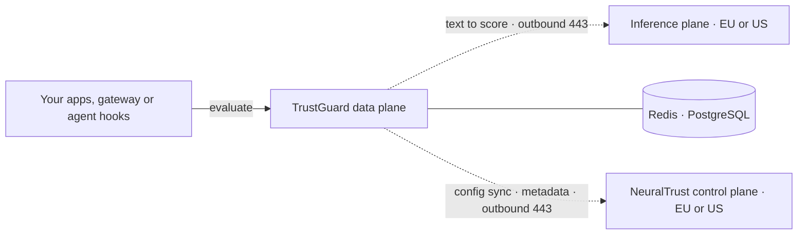

  Start from one of these shapes rather than from a blank values file. Each one
  is a supported combination of the three planes, with a known footprint and an
  install guide you can follow from top to bottom.

If the terms *control plane*, *data plane* and *inference plane* are new, read
[the three planes](/neuraltrust/deployment/overview#the-three-planes) first.
Every shape here uses the same chart; what changes is which planes you run and
which ones NeuralTrust runs for you in the [EU or US region](/neuraltrust/deployment/overview#regions).

## At a glance

| Architecture | Control plane | Data plane | Inference plane | What leaves your environment | Minimum nodes | Install guide |
| --- | --- | --- | --- | --- | --- | --- |
| [**1. Hybrid**](#1-hybrid) | NeuralTrust, EU or US | You: TrustGate and TrustGuard | NeuralTrust, same region | Config requests, metadata, text to score | 2 × 8 vCPU / 16 GiB | [Hybrid](/neuraltrust/deployment/hybrid) |
| [**2. Gateway only**](#2-gateway-only) | NeuralTrust, EU or US | You: TrustGate | — | Config requests, metadata | 2 × 8 vCPU / 16 GiB | [TrustGate data plane](/neuraltrust/deployment/trustgate) |
| [**3. Detection only**](#3-detection-only) | NeuralTrust, EU or US | You: TrustGuard | NeuralTrust, same region | Config requests, metadata, text to score | 2 × 8 vCPU / 16 GiB | [TrustGuard data plane](/neuraltrust/deployment/trustguard) |
| [**4. Hybrid, region resilient**](#4-hybrid-region-resilient) | NeuralTrust, EU or US | You, in two regions | NeuralTrust, same region | As Hybrid | Hybrid sizing, per cluster | [Hybrid](/neuraltrust/deployment/hybrid#high-availability) |
| [**5. Self-hosted**](#5-self-hosted) | You | You | NeuralTrust, EU or US | Text to score | 3 × 8 vCPU / 16 GiB | [Self-hosted](/neuraltrust/deployment/external) |
| [**6. Self-hosted, air-gapped**](#6-self-hosted-air-gapped) | You | You | You | Nothing | 4 × 8 vCPU / 32 GiB | [Self-hosted](/neuraltrust/deployment/external) |
| [**7. Multi-cluster, one console**](#7-multi-cluster-one-console) | You, in a central cluster | You, in several clusters | NeuralTrust, EU or US — or you | Text to score, unless every cluster runs its own Firewall | Central as Self-hosted, plus Hybrid sizing per data plane | [Central control plane](/neuraltrust/deployment/central) |

Node counts are the minimum of an autoscaled node pool with the Firewall on CPU.
Running the Firewall in your cluster adds nodes to any shape; the full table,
including GPU pools, is in [Capacity](/neuraltrust/deployment/architecture#capacity).

## 1. Hybrid

**The default, and the shortest path to production.** You run TrustGate and
TrustGuard in one cluster; NeuralTrust runs the console, analytics and the ML
detectors in your region.

| | |
| --- | --- |
| **Choose it when** | Prompts and responses must stay in your environment, and NeuralTrust may run the console |
| **You run** | TrustGate, TrustGuard, the data-plane API and DataAgent, on your PostgreSQL and Redis |
| **NeuralTrust runs** | The console, configuration, analytics and the Firewall, in your tenant's region |
| **Crosses your boundary** | Outbound 443 for config sync, metadata, DataBridge and scoring; one inbound rule for the console to reach your published LLM and MCP entry points |
| **Raw payloads** | Your PostgreSQL. They never leave the cluster |

## 2. Gateway only

**TrustGate on its own**, governing LLM and MCP traffic between your
applications, agents and model providers, with no TrustGuard in the path.

| | |
| --- | --- |
| **Choose it when** | You need routing, policies, budgets and MCP governance now, and runtime detection later or elsewhere |
| **You run** | `agentgateway-proxy`, `agentgateway-mcp` and one DataAgent |
| **Crosses your boundary** | Outbound 443 for config sync, metadata and DataBridge; the inbound rule to the `:8081` and `:8082` entry points |
| **Grows into** | Hybrid: add TrustGuard to the same release later, with its own console instance and tokens |

## 3. Detection only

**TrustGuard on its own**, as a detection API your applications, your existing
gateway or your agent hooks call synchronously before they decide how to
enforce.

| | |
| --- | --- |
| **Choose it when** | You already run a gateway, or you want detection in code paths that never go through one |
| **You run** | `trustguard-data-plane` and `dataagent-trustguard` |
| **Crosses your boundary** | Outbound 443 for config sync, metadata, DataBridge and scoring. No inbound rule: nothing outside the cluster needs to reach TrustGuard |
| **Variant** | Keep scoring in the cluster with the in-cluster Firewall: 3 × 8 vCPU / 16 GiB, or a GPU pool |

## 4. Hybrid, region resilient

**Two Hybrid clusters in two regions, active/passive**, for a request path that
has to survive losing a whole cloud region.

| | |
| --- | --- |
| **Choose it when** | A regional requirement says one cluster across three zones is not enough. Most deployments should stop at [tier 1](/neuraltrust/deployment/high-availability#tier-1-one-cluster-across-zones) |
| **You run** | Two full Hybrid clusters, one PostgreSQL primary with a cross-region replica, and one Redis per region |
| **Both clusters** | Pull the same configuration from the same NeuralTrust region independently, and call the same regional inference plane |
| **Only the active cluster** | Runs DataAgent, and receives traffic from your traffic manager |

Your cloud regions and the NeuralTrust region are independent: two clusters in
two of your regions still enrol into the one NeuralTrust region your tenant
lives in.

## 5. Self-hosted

**Every plane in your cluster except the ML detectors.** The console, product
control planes and analytics run next to the data plane; the only connection to
NeuralTrust is TrustGuard's scoring call to the hosted inference plane.

| | |
| --- | --- |
| **Choose it when** | Policy forbids any dependency on NeuralTrust SaaS for configuration or analytics, but stateless scoring by the hosted Firewall is acceptable |
| **You run** | Request path, console, both product control planes, ClickHouse, DataCore and AlertEngine, on your PostgreSQL and Redis |
| **NeuralTrust runs** | The inference plane, in the region your firewall key was issued for |
| **Crosses your boundary** | Outbound 443 to `firewall.neuraltrust.ai` or `firewall.us.neuraltrust.ai`, or Private Service Connect. No inbound rule from NeuralTrust |
| **You take on** | Migrations, backups of PostgreSQL and ClickHouse, email deliverability, and a break-glass administrator — see [What you have taken on](/neuraltrust/deployment/external#what-you-have-taken-on) |

## 6. Self-hosted, air-gapped

**Architecture 5 with the Firewall in your cluster and images from your own
registry.** Nothing connects to NeuralTrust at runtime.

| | |
| --- | --- |
| **Choose it when** | The cluster cannot reach the internet, or no text may leave your environment even for stateless scoring |
| **Differs from 5 in** | The Firewall runs in-cluster (`global.firewall.deploy: true`); images are mirrored to an internal registry; hosted telemetry export is off |
| **Crosses your boundary** | Nothing to NeuralTrust. Only your own registry, LLM upstreams, datastores, email and SIEM |
| **Costs you** | The Firewall's capacity — 4 × 8 vCPU / 32 GiB on CPU, or a GPU pool — and operating it yourself |

The steps are the Self-hosted install with the air-gapped settings from its
[Network](/neuraltrust/deployment/external#network) section and
[Mirror to your own registry](/neuraltrust/deployment/images#mirror-to-your-own-registry).

## 7. Multi-cluster, one console

**A central control plane you run, with data planes in other clusters enrolled
into it.** Each data plane keeps its raw payloads; the console, alerting and
cross-cluster reporting live in one place.

| | |
| --- | --- |
| **Choose it when** | Data has to stay where it was produced — separate business units, jurisdictions or environments — but one console has to see all of it. If everything fits in one cluster, architecture 5 is simpler |
| **You run** | One central cluster, a Self-hosted install plus DataBridge, an ingest gateway and published config-sync endpoints; and one Hybrid-style data-plane cluster per site |
| **Data planes connect to** | Your central cluster on four endpoints under your own domain — never to NeuralTrust's control plane |
| **Crosses your boundary** | Only the scoring call to the inference plane, from every cluster that runs TrustGuard, unless it runs the Firewall itself |

The data planes here are installed exactly like a
[TrustGate](/neuraltrust/deployment/trustgate) or
[TrustGuard](/neuraltrust/deployment/trustguard) data plane, pointed at your
domain instead of at NeuralTrust.

## Make any of them resilient

Every architecture starts at tier 1 of the availability ladder — one cluster,
replicas across three zones, managed PostgreSQL and Redis — and that is enough
for most deployments. Climb further only for a failure you actually have to
survive.

<Card title="High availability" icon="layers" href="/neuraltrust/deployment/high-availability">
  The four tiers, what each survives, and what changes per deployment model.
</Card>
