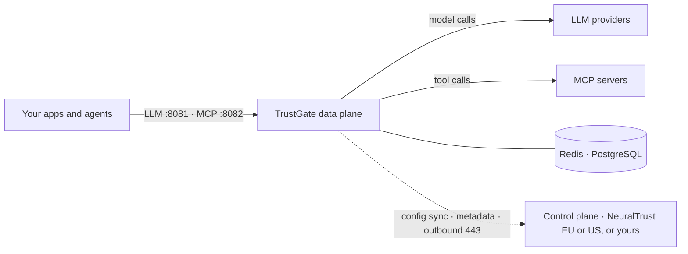

<p className="nt-lead">
  A TrustGate data plane is the gateway in your request path: it routes,
  secures and observes LLM and MCP traffic between your applications, agents
  and model providers. It runs in your cluster and enrols into a control plane,
  which configures it and receives its metadata.
</p>

**TrustGate** is open source under the Apache 2.0 license. This page installs it
on its own — the [Gateway only](/neuraltrust/deployment/reference-architectures#2-gateway-only)
reference architecture — enrolled into NeuralTrust SaaS in your tenant's region.
To enrol it into a control plane you run instead, follow the same steps with the
change in [Connect to your own control plane](#connect-to-your-own-control-plane).
To run TrustGate and TrustGuard together, follow [Hybrid](/neuraltrust/deployment/hybrid)
instead.

## What you are installing



This install runs `agentgateway-proxy` (LLM, port 8081), `agentgateway-mcp`
(MCP, port 8082), and one `dataagent`. TrustGate pulls its configuration from the
control plane, and DataAgent ships its metadata out and answers the console's
authorized queries; raw prompts and responses stay in your PostgreSQL.

| Resource | Where |
| --- | --- |
| Source code | [github.com/NeuralTrust/TrustGate](https://github.com/NeuralTrust/TrustGate) |
| Container image | `agentgateway`, in the NeuralTrust registry: see [Images](/neuraltrust/deployment/images) |
| Product slice | [`values-trustgate.yaml.example`](https://github.com/NeuralTrust/neuraltrust-platform/blob/main/values-trustgate.yaml.example) |

The TrustGate image and its chart values block are named `agentgateway`. That
is the same product; see the
[naming map](/neuraltrust/deployment/console-setup#one-product-four-names).

<Note>
The TrustGate image is published to the NeuralTrust container registry. Pulling
it requires a registry key, which NeuralTrust issues with an enterprise offer —
[contact NeuralTrust](mailto:support@neuraltrust.ai) to get one.
</Note>

## Before you start

The [Hybrid prerequisites](/neuraltrust/deployment/hybrid#prerequisites) apply
here. For TrustGate alone, that comes down to:

- [ ] **Your tenant's region**, EU or US — see [Choose your region](/neuraltrust/deployment/hybrid#choose-your-region)
- [ ] **A cluster** with an ingress controller and Helm 3.8+: **2** nodes of 8 vCPU / 16 GiB as the minimum of an autoscaled node pool
- [ ] **A base domain** you can point at the cluster ingress, for example `platform.example.com`
- [ ] **Redis and PostgreSQL** the cluster can reach. TrustGate refuses to start without Redis — see [Check your datastores first](/neuraltrust/deployment/hybrid#check-your-datastores-first)
- [ ] **The registry key**
- [ ] **The network rules** below
- [ ] **Console access** in your region, to create a private gateway

### Network for TrustGate alone

Allow outbound **TCP 443** to the hosts of your region. TrustGate needs no
TrustGuard config-sync host, and no Firewall host unless you give it a firewall
JWT for smart routing.

| Purpose | EU | US |
| --- | --- | --- |
| TrustGate config sync | `agentgateway-configsync.neuraltrust.ai` | `agentgateway-configsync.us.neuraltrust.ai` |
| DataAgent DataBridge | `databridge.neuraltrust.ai` | `databridge.us.neuraltrust.ai` |
| Metadata OTLP export | `telemetry.neuraltrust.ai` | `telemetry.us.neuraltrust.ai` |

Static IPs for the EU hosts are in [Hybrid → Network](/neuraltrust/deployment/hybrid#network).

Inbound, your published `:8081` and `:8082` entry points must accept HTTPS from
the NeuralTrust source IP in [Hybrid → Inbound](/neuraltrust/deployment/hybrid#inbound).
Agree it with your network team before install day.

## Install

<Steps>

<Step title="Prepare the namespace and chart sources">

Do step 1 of the [Hybrid install](/neuraltrust/deployment/hybrid#install) to
create the namespace and the image pull Secret, then [get the chart sources](/neuraltrust/deployment/images#get-the-chart-sources)
so `values-trustgate.yaml.example` is on disk.

</Step>

<Step title="Create the gateway in the console">

In the console of your tenant's region, open **TrustGate → New Gateway**, name
it, choose **Private**, then **Kubernetes**. Take the `CONFIG_SYNC_TOKEN` and the
DataAgent enrollment JWT from the wizard output — see
[Console setup](/neuraltrust/deployment/console-setup).

</Step>

<Step title="Create the two Secrets">

```bash
kubectl create secret generic agentgateway-config-sync -n neuraltrust \
  --from-literal=CONFIG_SYNC_TOKEN='<trustgate-config-sync-token>'

kubectl create secret generic dataagent-enrolment-trustgate -n neuraltrust \
  --from-literal=ENROLMENT_TOKEN='<trustgate-enrolment-jwt>'
```

</Step>

<Step title="Install">

Put the cluster-specific values in their own file:

```yaml values-cluster.yaml
global:
  platform: "kubernetes"          # aws | gcp | azure | openshift | kubernetes
  domain: "platform.example.com"
```

For a US tenant, also add `saasRegion: "us"` under `global` in that file — see
[Choose your region](/neuraltrust/deployment/hybrid#choose-your-region).

Then install with the TrustGate slice, which turns on
`global.products.trustgate` and wires the two Secrets:

```bash
helm upgrade --install neuraltrust-platform \
  oci://europe-west1-docker.pkg.dev/neuraltrust-app-prod/helm-charts/neuraltrust-platform \
  --version <VERSION> \
  --namespace neuraltrust \
  -f values-cluster.yaml \
  -f values-trustgate.yaml.example
```

</Step>

<Step title="Verify, expose and register both entry points">

You should see `agentgateway-proxy`, `agentgateway-mcp` and `dataagent`. The
gateway reports Ready only after it has pulled its configuration, so a pod that
is `Running` but never `Ready` means config sync is failing — see
[Hybrid → Verify](/neuraltrust/deployment/hybrid#verify) for the causes.

Then expose the LLM and MCP hostnames and set **both** URLs in the console, as
described in
[Expose both entry points](/neuraltrust/deployment/hybrid#expose-both-entry-points).
A single URL works for LLM traffic and quietly breaks MCP.

</Step>

</Steps>

Before handing the gateway over, work through the
[validation checklist](/neuraltrust/deployment/validation): DNS and TLS from the
caller's network, and MCP tested separately from the LLM route.

## Connect to your own control plane

To enrol this data plane into a [central control plane](/neuraltrust/deployment/central)
you run, rather than into NeuralTrust SaaS, make three changes to the steps
above:

1. **Point it at your domain.** Set `global.controlPlane.domain` in
   `values-cluster.yaml` instead of a region; it moves config sync, DataBridge
   and telemetry together.

   ```yaml
   global:
     controlPlane:
       domain: nt.example.com
   ```

2. **Take the tokens from your console**, not from NeuralTrust's. Mint one
   enrolment token per data plane — see
   [Telling data planes apart](/neuraltrust/deployment/central#telling-data-planes-apart).
3. **Allow egress to your central cluster** instead of to NeuralTrust:
   `agentgateway-configsync.<domain>`, `databridge.<domain>` and
   `telemetry.<domain>` on 443. If the central cluster serves chart-generated
   certificates, trust its CA as in
   [Trusting a chart-generated control plane](/neuraltrust/deployment/central#trusting-a-chart-generated-control-plane).

## Next steps

<CardGroup cols={2}>
  <Card title="TrustGuard data plane" icon="shield" href="/neuraltrust/deployment/trustguard">
    Add runtime detection in its own data plane.
  </Card>
  <Card title="High availability" icon="layers" href="/neuraltrust/deployment/high-availability">
    Replicas across zones, and the ladder beyond one cluster.
  </Card>
  <Card title="Configuration" icon="sliders-horizontal" href="/neuraltrust/deployment/configuration">
    Managed stores, ingress, TLS, and every values switch.
  </Card>
  <Card title="Troubleshooting" icon="wrench" href="/neuraltrust/deployment/troubleshooting">
    Install, pod, config-sync, and telemetry failures.
  </Card>
</CardGroup>
