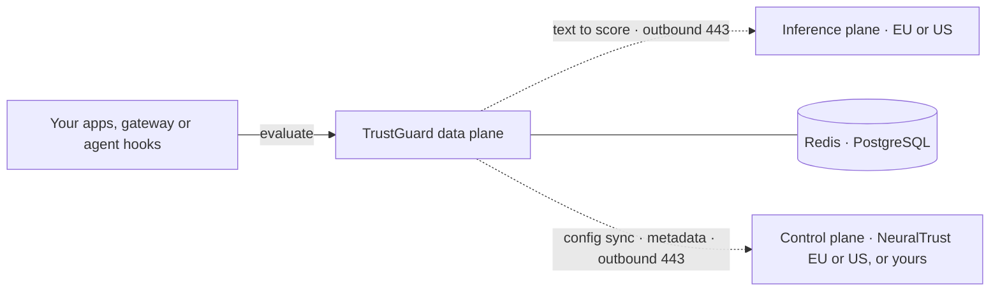

<p className="nt-lead">
  A TrustGuard data plane is the detection engine in your request path. It
  evaluates prompts, responses and tool calls against your policies and returns
  findings; your applications or gateway call it synchronously and decide how
  to enforce. It runs in your cluster, enrols into a control plane, and sends
  the text its ML detectors score to the inference plane.
</p>

**TrustGuard** is NeuralTrust's commercial offering and is licensed to
enterprise customers. This page installs it on its own — the
[Detection only](/neuraltrust/deployment/reference-architectures#3-detection-only)
reference architecture — enrolled into NeuralTrust SaaS in your tenant's region.
To enrol it into a control plane you run instead, follow the same steps with the
change in [Connect to your own control plane](#connect-to-your-own-control-plane).
To run TrustGate and TrustGuard together, follow [Hybrid](/neuraltrust/deployment/hybrid)
instead.

## What you are installing



This install runs `trustguard-data-plane` (port 8081) and `dataagent-trustguard`.
Its ML detectors run on the NeuralTrust-hosted
[inference plane](/neuraltrust/deployment/inference-plane), in your control
plane's region; set `global.firewall.deploy: true` to run the Firewall in your
cluster instead.

| Resource | Where |
| --- | --- |
| Source code | [github.com/NeuralTrust/TrustGuard](https://github.com/NeuralTrust/TrustGuard) (private) |
| Container image | `trustguard`, in the NeuralTrust registry: see [Images](/neuraltrust/deployment/images) |
| Product slice | [`values-trustguard.yaml.example`](https://github.com/NeuralTrust/neuraltrust-platform/blob/main/values-trustguard.yaml.example) |

<Note>
The TrustGuard image is published to the NeuralTrust container registry.
Pulling it requires a registry key, which NeuralTrust issues with an enterprise
offer — [contact NeuralTrust](mailto:support@neuraltrust.ai) to get one. See [Container images](/neuraltrust/deployment/images) for pulling
directly or mirroring into your own registry.
</Note>

## Before you start

The [Hybrid prerequisites](/neuraltrust/deployment/hybrid#prerequisites) apply
here. For TrustGuard alone, that comes down to:

- [ ] **Your tenant's region**, EU or US — see [Choose your region](/neuraltrust/deployment/hybrid#choose-your-region)
- [ ] **Where the ML detectors run**: the hosted inference plane (default), or your cluster — see [Inference plane](/neuraltrust/deployment/inference-plane#run-it-in-your-cluster-instead)
- [ ] **A cluster** with an ingress controller and Helm 3.8+: **2** nodes of 8 vCPU / 16 GiB with the hosted Firewall, or **3** with it in your cluster, as the minimum of an autoscaled node pool — see [Capacity](/neuraltrust/deployment/architecture#capacity)
- [ ] **A base domain** you can point at the cluster ingress, for example `platform.example.com`
- [ ] **Redis and PostgreSQL** the cluster can reach — see [Check your datastores first](/neuraltrust/deployment/hybrid#check-your-datastores-first)
- [ ] **The registry key**
- [ ] **The network rules** below
- [ ] **Console access** in your region, to create a private TrustGuard. Its firewall JWT is shown only once

### Network for TrustGuard alone

Allow outbound **TCP 443** to the hosts of your region. TrustGuard needs no
TrustGate config-sync host, and no inbound rule: nothing outside the cluster
has to reach it.

| Purpose | EU | US |
| --- | --- | --- |
| TrustGuard config sync | `trustguard-configsync.neuraltrust.ai` | `trustguard-configsync.us.neuraltrust.ai` |
| DataAgent DataBridge | `databridge.neuraltrust.ai` | `databridge.us.neuraltrust.ai` |
| Metadata OTLP export | `telemetry.neuraltrust.ai` | `telemetry.us.neuraltrust.ai` |
| Inference plane, unless the Firewall runs in your cluster | `firewall.neuraltrust.ai` | `firewall.us.neuraltrust.ai` |

Static IPs for the EU hosts are in [Hybrid → Network](/neuraltrust/deployment/hybrid#network).
The inference plane can also be reached over Private Service Connect — see
[Inference plane → Reach it](/neuraltrust/deployment/inference-plane#reach-it).

## Install

<Steps>

<Step title="Prepare the namespace and chart sources">

Do step 1 of the [Hybrid install](/neuraltrust/deployment/hybrid#install) to
create the namespace and the image pull Secret, then [get the chart sources](/neuraltrust/deployment/images#get-the-chart-sources)
so `values-trustguard.yaml.example` is on disk.

</Step>

<Step title="Create the TrustGuard in the console">

In the console of your tenant's region, create a private TrustGuard in
**TrustGuard → Agent Security**. Take the `CONFIG_SYNC_TOKEN`, the DataAgent
enrollment JWT and the `FIREWALL_JWT` from the wizard output — see
[Console setup](/neuraltrust/deployment/console-setup).
The console shows the `FIREWALL_JWT` only once.

</Step>

<Step title="Create the three Secrets">

```bash
kubectl create secret generic trustguard-config-sync -n neuraltrust \
  --from-literal=CONFIG_SYNC_TOKEN='<trustguard-config-sync-token>'

kubectl create secret generic dataagent-enrolment-trustguard -n neuraltrust \
  --from-literal=ENROLMENT_TOKEN='<trustguard-enrolment-jwt>'

kubectl create secret generic trustguard-firewall -n neuraltrust \
  --from-literal=FIREWALL_JWT='<trustguard-firewall-jwt>'
```

To run the Firewall in your cluster, skip `trustguard-firewall` and add
`global.firewall.deploy: true` to `values-cluster.yaml` below.

</Step>

<Step title="Install">

Put the cluster-specific values in their own file:

```yaml values-cluster.yaml
global:
  platform: "kubernetes"          # aws | gcp | azure | openshift | kubernetes
  domain: "platform.example.com"
```

For a US tenant, also add `saasRegion: "us"` under `global` in that file — see
[Choose your region](/neuraltrust/deployment/hybrid#choose-your-region).

Then install with the TrustGuard slice, which turns on
`global.products.trustguard` and wires the three Secrets:

```bash
helm upgrade --install neuraltrust-platform \
  oci://europe-west1-docker.pkg.dev/neuraltrust-app-prod/helm-charts/neuraltrust-platform \
  --version <VERSION> \
  --namespace neuraltrust \
  -f values-cluster.yaml \
  -f values-trustguard.yaml.example
```

</Step>

<Step title="Verify">

You should see `trustguard-data-plane` and `dataagent-trustguard`, plus
`firewall` and its workers with `global.firewall.deploy: true`. TrustGuard
reports Ready only after it has pulled its configuration, so a pod that is
`Running` but never `Ready` means config sync is failing — see
[Hybrid → Verify](/neuraltrust/deployment/hybrid#verify) for the causes.

With the hosted inference plane, the TrustGuard data plane logs
`firewall client loaded from FIREWALL_JWT` at startup, with the `base_url` it
calls; check that it names your region's Firewall host. TrustGuard is published
at `trustguard.<domain>`.

</Step>

</Steps>

Before handing it over, work through the
[validation checklist](/neuraltrust/deployment/validation): DNS and TLS from the
caller's network, policy decisions, and telemetry arriving.

## Connect to your own control plane

To enrol this data plane into a [central control plane](/neuraltrust/deployment/central)
you run, rather than into NeuralTrust SaaS, make three changes to the steps
above:

1. **Point it at your domain.** Set `global.controlPlane.domain` in
   `values-cluster.yaml` instead of a region; it moves config sync, DataBridge
   and telemetry together.

   ```yaml
   global:
     controlPlane:
       domain: nt.example.com
   ```

2. **Take the config-sync and enrolment tokens from your console**, not from
   NeuralTrust's, and mint one enrolment token per data plane — see
   [Telling data planes apart](/neuraltrust/deployment/central#telling-data-planes-apart).
   Your console does not issue firewall keys: ask NeuralTrust for one for this
   cluster, or run the Firewall in it.
3. **Allow egress to your central cluster** instead of to NeuralTrust's control
   plane: `trustguard-configsync.<domain>`, `databridge.<domain>` and
   `telemetry.<domain>` on 443, plus the inference plane host your firewall key
   names. If the central cluster serves chart-generated certificates, trust its
   CA as in
   [Trusting a chart-generated control plane](/neuraltrust/deployment/central#trusting-a-chart-generated-control-plane).

## Next steps

<CardGroup cols={2}>
  <Card title="Inference plane" icon="globe" href="/neuraltrust/deployment/inference-plane">
    Regions, what the Firewall receives, and running it yourself.
  </Card>
  <Card title="TrustGate data plane" icon="door-open" href="/neuraltrust/deployment/trustgate">
    Put the gateway in front, in its own data plane.
  </Card>
  <Card title="High availability" icon="layers" href="/neuraltrust/deployment/high-availability">
    Replicas across zones, and the ladder beyond one cluster.
  </Card>
  <Card title="Troubleshooting" icon="wrench" href="/neuraltrust/deployment/troubleshooting">
    Install, pod, config-sync, Firewall, and telemetry failures.
  </Card>
</CardGroup>
