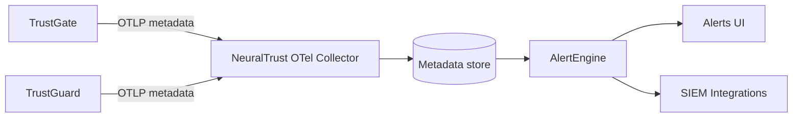

# Event schema

[Alerts](/platform/alerts) and [Use Cases](/platform/use-cases) evaluate rules over **metadata events** stored in the NeuralTrust metadata store. TrustGuard and TrustGate each emit one metadata record per request over **OpenTelemetry (OTLP)**; a collector ingests them into separate **TrustGate** and **TrustGuard** event streams.

<Warning>
**No raw prompt or response text** is in the metadata stream. Identifiers, verdicts, counters, and finding labels only. Raw bodies live in a separate store keyed by `trace_id` for drill-down in the UI.
</Warning>

---

## Architecture

| Stream | Storage | Used for |
|---|---|---|
| Metadata + findings | NeuralTrust metadata store (TrustGate and TrustGuard streams) | Rules, alerts, logs list |
| Raw payload | Client-local Postgres (hybrid) or SaaS Postgres | Prompt/response drill-down by `trace_id` |

Correlation keys across streams: `tenant_id`, `trace_id`, `session_id`.

Rules over TrustGuard read only the evaluations TrustGuard acted on. Shadow copies — a second evaluation of a request that is already recorded — are stored but never matched.

---

## Rule fields

A **rule field** is a key a rule may use in `match:` or `detection:`. Every rule field is listed below, and every one is offered in the [Use Cases](/platform/use-cases#field-picker) field picker for the products it exists for. AlertEngine rejects any other key when a rule is saved, and a field used on a product it does not exist for.

**Aliases** are older names that resolve to the same field, so stored rules keep working. The builder writes the canonical name.

### Both products

| Rule field | Aliases | Stored as | Notes |
|---|---|---|---|
| `status.code` | `http_status` | `http_status` | HTTP status |
| `status.outcome` | — | `status_outcome` | TrustGuard: `block` \| `transform` \| `report` \| `allow` \| `skip` \| `ask` \| `error` (`error` when the HTTP status is 4xx/5xx). TrustGate: `success` \| `retryable` \| `terminal`, the result of the last provider attempt; not set on MCP events or when no provider was called (for example, a request a policy refused first). A rule is validated against its own product's list. |
| `is_flagged` | — | `is_flagged` | TrustGuard: 1 when any finding fires or the outcome is not `allow` (so `skip` and `error` are flagged). TrustGate: 1 when a policy blocked, reported, or throttled the request, failed, or returned 4xx/5xx. |
| `security` | — | `security` (JSON array) | Security tag labels. `contains` only |
| `http_method` | — | `http_method` | HTTP verb |
| `route` | `url_path` | `url_path` | HTTP path |
| `consumer` | `entity`, `consumer.id` | `consumer_id` | The application (entity) behind the request — **Application** in the console |
| `consumer.name` | `consumer_name` | `consumer_name` | Display name |
| `session` | `session_id` | `session_id` | Session grouping |
| `trace_id` | — | `trace_id` | Correlation to the raw payload |
| `total_ms` | `latency.total_ms` | `latency` JSON `.total_ms` | End-to-end latency |

### TrustGate only

| Rule field | Aliases | Stored as | Notes |
|---|---|---|---|
| `model` | `request_model` | `request_model` | LLM model |
| `provider` | — | `provider` | Upstream provider |
| `kind` | — | `kind` | `llm` \| `mcp` \| `a2a` |
| `gateway_id` | — | `gateway_id` | Source gateway |
| `latency.provider_ms`, `latency.policies_ms`, `latency.routing_ms`, `latency.gateway_ms` | — | `latency` JSON | Time waiting on the provider, evaluating policies, routing, and inside the gateway |
| `usage.input_tokens`, `usage.output_tokens`, `usage.total_tokens` | `total_tokens` (for `usage.total_tokens`) | `usage` JSON | Token counts. `usage.input_tokens` is the whole prompt. See [Prompt caching](/trustgate/concepts/prompt-caching#usage-and-cost). |
| `cost.total_usd`, `cost.prompt_usd`, `cost.completion_usd` | — | `cost` JSON | Cost in USD. TrustGate rates: [registry contract pricing](/trustgate/registry/models#contract-pricing) when set. A request that carried no cost stores an empty object, so these read 0. |
| `cost.savings_usd` | — | `cost` JSON `.savings_usd` | Cost saved by smart routing. Present only when smart routing's tier table chose the route; `0` when the top tier was served. An absent key also reads 0 in a rule, so match savings with `gt` rather than testing for zero. |
| `cost.currency` | — | `cost` JSON `.currency` | Currency of the cost |
| `mcp.method`, `mcp.operation`, `mcp.server_name`, `mcp.tool`, `mcp.transport`, `mcp.upstream_status` | — | `mcp` JSON | MCP call metadata, as text. Empty on non-MCP requests |
| `mcp.rpc_error_code` | — | `mcp` JSON `.rpc_error_code` | JSON-RPC error code the MCP server returned; 0 when the call did not fail |
| `policy.failed_open` | — | Derived from `policy_chain` and `mcp` | True when any `policy_chain` entry has `decision = failed_open` and its `extras.failure_reason` is not `counter_unavailable`, or when the MCP call itself failed open (`mcp.decision = failed_open`). Guardrail policies record `failed_open` when they cannot give a verdict; a rate limiter that lost its counter is excluded because that is a limiter outage, not a gap in inspection. |

### TrustGuard only

| Rule field | Aliases | Stored as | Notes |
|---|---|---|---|
| `direction` | `request.direction` | `request_direction` | `input` \| `output` — required for output-leak rules |
| `protocol` | `request.protocol` | `request_protocol` | `llm` \| `mcp` \| `a2a` |
| `collector_id` | — | `collector_id` | Source collector |
| `collector_name` | — | `collector_name` | Display name |
| `guard_id` | — | `guard_id` | TrustGuard instance (one per environment) the collector belongs to |
| `policy_id` / `policy_name` | — | `policy_id` / `policy_name` | Evaluating policy |
| `latency.detectors_ms` / `latency.overhead_ms` | — | `latency` JSON | Detector timing |
| `coverage.not_evaluated` | — | Derived from `detector_chain` | True when any detector failed to run: an entry with `not_executed = true` and a `not_executed_reason` of `execution_failed`, `plugin_panic`, `unknown_plugin`, `invalid_plugin_config`, `missing_dependency`, `timeout`, or `backend_overloaded`. Refusals (`payload_too_large`, `content_uninspectable`, `ambiguous_payload`) and `partial_stream_block` are not counted. |
| `coverage.failed_detectors` | — | Derived from `detector_chain` | How many detectors failed to run, by the same rule |
| `detection.type`, `detection.action`, `detection.confidence`, `detection.enforced` | — | Derived from `detector_chain` | `detection:` block only — see [Detection matching](#detection-matching-trustguard) |

---

## Entity and grouping

**Entity** is not a stored column. AlertEngine derives it from `consumer_id`, the reference for "who" triggered the event.

| Group key | Stored as | Notes |
|---|---|---|
| `entity` / `consumer` | `consumer_id` | Default alert subject, shown as **Application** |
| `session` | `session_id` | Session-scoped bursts |
| `app` | `gateway_id` (TrustGate) or `collector_id` (TrustGuard) | Per-gateway or per-collector |
| `route` | `url_path` | Per HTTP path. The builder offers it for TrustGate |

A rule's `group_by` can be `app` or any rule field of its product except the `detection.*` fields, which have no single value per event. A cross rule's `correlate_on` can be any rule field both products have. The builder offers the keys in this table, and **Application** or **Session** for `correlate_on`.

Each event also stores the client **`ip`**, for investigation. It is not a rule field: rules cannot match or group on it, so surge and anomaly rules group by **session** or **consumer**. Predefined `nt-uc-111` (Unidentified Consumer Surge) groups by **session**.

---

## Detection matching (TrustGuard)

Rules with a `detection:` block match over the raw **`detector_chain`** JSON array. AlertEngine normalizes each element **at query time** (not as a stored column). TrustGuard writes elements in two shapes: a flat one that carries `detection_type` and `action` directly, and a nested one with `source.plugin`, `signal`, and `outcome`. Each field reads the flat key first.

### Rule detection fields

| Field | Meaning |
|---|---|
| `detection.type` | Canonical category: `prompt_injection`, `secrets`, `pii`, `toxicity`, `behavioral_threat`, `multi_turn_escalation`, `code_injection` |
| `detection.action` | `action`, else `outcome.action`: `block`, `transform`, or `report` |
| `detection.confidence` | 0–1 score: the higher of `confidence` and `signal.confidence` |
| `detection.enforced` | Derived: true when the action is `block` or `transform` |

### Plugin → type mapping (nested chain)

When the flat `detection_type` field is empty, type is derived from `source.plugin`:

| Plugin | Canonical `detection.type` |
|---|---|
| `prompt_guard`, `tool_guard` | `prompt_injection` |
| `data_loss_prevention` + `signal.type=secret` | `secrets` |
| `data_loss_prevention` (else) | `pii` |
| `toxicity` | `toxicity` |
| `anomaly_detector` | `behavioral_threat` |
| `multiturn_guard` | `multi_turn_escalation` |
| `code_sanitation` | `code_injection` |
| Any other plugin | `signal.type`, with `jailbreak` read as `prompt_injection` |

### Finding guard

An element counts as a finding only when it carries a `detection_type`, an `action` or `outcome.action`, or a `signal.type`. Elements that only record that a detector **ran** on a clean request do not count, and neither does a detector that failed to run (`not_executed`): those are matched by the `coverage.*` fields instead.

---

## Stored fields that are not rule fields

These are part of each stored event, for Activity, investigation, and analytics, but rules cannot match them.

### TrustGate

| Stored as | Notes |
|---|---|
| `ip` | Client IP |
| `end_user` | The person a client application declared it was serving — one identifier. Caller-asserted, never verified: see [End-user attribution](/trustgate/observability/end-user-attribution). |
| `end_user_detail` (JSON) | The whole declaration: `id`, `email`, `name`, `role`, `source`. |
| `principal_subject` / `principal_email` / `principal_method` | The credential that actually authenticated. Distinct from `end_user` on purpose. |
| `usage` JSON: `cached_input_tokens`, `cache_write_input_tokens`, `cache_write_1h_input_tokens`, `tool_use_input_tokens`, `reasoning_output_tokens` | Parts of the token counts: cache reads and writes, tool-use input, and reasoning output. See [Prompt caching](/trustgate/concepts/prompt-caching#usage-and-cost). |
| `mcp` JSON: `tool_risk`, `tool_open_world` | The tool's declared risk — `read_only`, `additive`, `destructive`, or empty when the tool declares no annotation — and whether it is marked open world (it reaches systems beyond its own server). See [MCP analytics](/trustgate/mcp/analytics#tool-risk). |
| `mcp` JSON: `decision` | `failed_open` when a guard or plugin stage errored on the call and the gateway let it through. Matched through `policy.failed_open`. |
| `policy_chain` (JSON array) | One entry per policy step: `name`, `stage`, `decision`, `flagged`, `latency_ms`, `extras`. Matched through `policy.failed_open`. |
| `a2a` (JSON) | A2A call metadata on `kind = a2a` requests: method, agent, task and its state, upstream status, outcome. |

### TrustGuard

| Stored as | Notes |
|---|---|
| `ip` | Client IP |
| `correlation_id` | The TrustGate trace ID when the gateway called TrustGuard |
| `user_id` / `user_email` | The original request identity |
| `status_reason` | Why a request failed: `invalid_attachment`, `invalid_request`, `rate_limited`, `unauthorized`, `forbidden`, `not_found`, or `other`. Empty for 2xx. |
| `api_key_id` / `api_key_masked` | The collector key that authenticated the call, in display form (`tgk_…6c22`), never the key itself. Empty for any other authentication, including traffic TrustGate forwards. Shown as **API key** in Activity. |
| `detector_chain` (JSON array) | The raw chain. Matched through `detection.*` and `coverage.*`. |
| `gates` (JSON) | Gate decisions |
| `attributes` (JSON) | Free-form attributes such as `model.name` and `model.provider` |
| `request_headers` / `response_headers` (JSON) | Sanitized header maps |

---

## Raw record fields shown in Activity

The raw store also keeps a few short fields derived from the body, so
**Activity** can show them without loading every payload. Like the bodies, they
never reach the metadata stream.

| Field | Product | Notes |
|---|---|---|
| `request_preview` | TrustGate | The start of the request, at most 200 characters. For LLM calls, the last user turn, so an agent loop shows the person's prompt, not tool output. For MCP `tools/call`, `tool(first string argument)`, skipping arguments named like credentials. Shown in the **Request** column and as the **First prompt** of a conversation. |
| `preview` | TrustGuard | The start of the evaluated content, at most 200 characters: the latest message that is not a system prompt, or the tool names of a tool list. Credentials are redacted first. Bodies over 1 MiB get none, and Activity leaves the **Request** column empty when DLP masked a value in the event. |
| `record_hash` | TrustGuard | Hex SHA-256 of the stored record (version `trustguard.record.v1`), shown as **Integrity** in Activity. Records are not chained to each other. |
| `client_trace_id` | TrustGate | The trace id of the caller's W3C `traceparent`, when it sent a single valid one. Never generated. A raw OTLP record also carries it as its own trace context, so an observability backend shows the gateway's record inside the trace of the agent that made the request. It never changes the gateway's own trace id or spans. |

On hybrid deployments the bodies stay in your data plane, so there is no preview
and Activity hides the **Request** column.

---

## What the builder does not create

Every rule field is in the builder. What it does not create are some rule shapes, which predefined use cases use:

- `aggregate` rules over a metric — `ratio`, `p95`, `p90`, `avg`, `sum` — and new `count_distinct` rules. A `count_distinct` rule is kept when copied or edited.
- A windowed rule with a `threshold` of 1, which raises one alert per window. In the builder, a threshold of 1 is a per-event rule.
- `group_by` on a key other than the four the builder offers.
- Rules over the console audit log (`stream: audit`).

See [Rule kinds](/platform/use-cases#rule-kinds-evaluation-models).

---

## Upstream requirements

For rules to match reliably, products must emit:

| Requirement | Product | Why |
|---|---|---|
| `consumer.id` populated | Both | Entity correlation and cross-product rules. If empty, cross rules can't join |
| `detector_chain` with `source.plugin`, `signal.type`, `signal.confidence`, and `outcome.action` | TrustGuard | Detection normalization |
| `request.direction` and `request.protocol` | TrustGuard | Output-leak rules (nt-uc-103/104/113) |
| `url.path` | TrustGate | Route-scoped operational rules (nt-uc-205/206) |
| `is_flagged` | TrustGuard | Flagged-event rules |

---

## Related documentation

<CardGroup cols={2}>
  <Card title="Use Cases" icon="list-checks" href="/platform/use-cases">
    Custom rule builder and full UI field catalog.
  </Card>
  <Card title="TrustGuard overview" icon="zap" href="/trustguard/overview">
    Guardrail detections that populate TrustGuard events.
  </Card>
</CardGroup>
