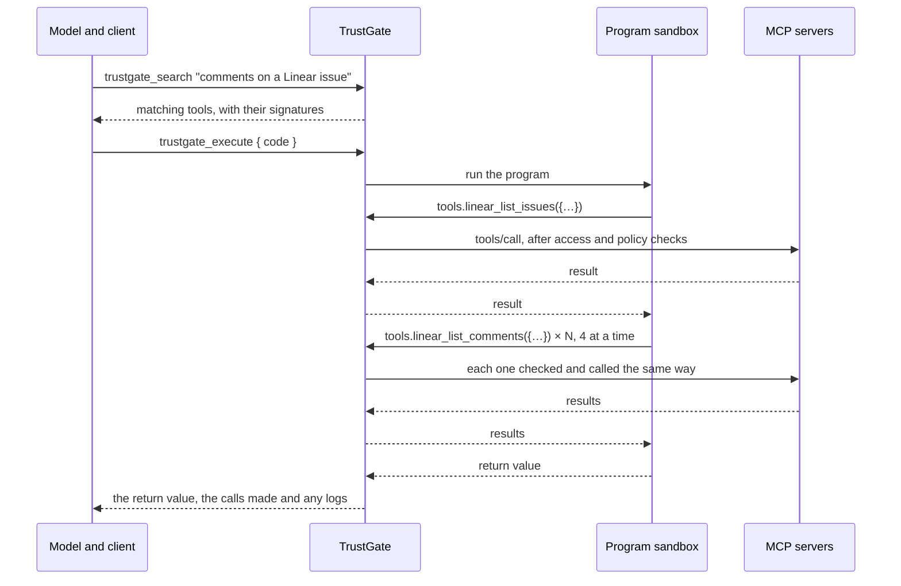

An agent that uses tools one at a time pays for every step twice: a round trip
through the model, and the step's whole result in the model's context. A task
like *which of my issues have no comments yet?* is one call to list the issues,
then one call per issue, and the model reads every comment of every issue only to
count them.

With **Code Mode**, the agent writes those steps as a short JavaScript program
instead. The gateway runs it next to the tools and sends back only what the
program returns:

```js
const { issues } = await tools.linear_list_issues({ state: "started", assignee: "me" });
const lists = await Promise.all(issues.map(i => tools.linear_list_comments({ issueId: i.id })));
return issues.filter((i, k) => lists[k].comments.length === 0).map(i => i.id);
```

```json
["ENG-103", "ENG-106"]
```

To the client, a program is one more tool call: nothing to install, and nothing
to change in the agent. The whole surface is two tools: `trustgate_search` to
find the user's tools, and `trustgate_execute` to run a program that calls them.
Every call the program makes is checked by the gateway like a direct call.

## Why it matters

Take that question with 54 started issues. Say the issue list is about 44 KB and
each issue's comments about 1.5 KB, an ordinary size for a server that returns
authors, dates and bodies.

| | One call at a time | One program |
|---|---|---|
| Tool calls the model makes | 55 | 1 |
| Tool output the model reads | ~125 KB, about 32,000 tokens | 21 bytes |
| Who counts the comments | the model, reading all 54 lists | the program |
| Calls in flight at once | as the client allows | up to 4, on the gateway |

What changes:

- **A smaller context.** Only the answer enters the conversation. The 125 KB
  never does, so it is not sent again on every later turn, and does not crowd
  the window that the rest of the task needs.
- **Fewer round trips.** The loop runs on the gateway, with no model turn
  between one call and the next.
- **Exact work.** Counting, filtering, joining and deduplicating are done by
  code. A model that reads 55 results to count them can miss one. A program
  does not.
- **The same governance.** Each call a program makes is checked like a direct
  call: access, consent, policies and rate limits. See [Governance and
  security](#governance-and-security).
- **Measured.** Activity and Analytics show, per program and per gateway, the
  calls made and the tokens kept out of context. See [Measuring the
  savings](#measuring-the-savings).

Code Mode helps when a task takes several calls: a loop over results, a filter, a
count, or a join across servers. A single call gains nothing from a program.
Call the tool directly.

## How it works



<Steps>
  <Step title="The model finds the tools">
    The model looks up the tools it needs with `trustgate_search`. Each match
    comes with its signature, which is how the program will call it:

    ```text
    • linear_list_comments — on Linear (read-only)
      List the comments on a Linear issue, oldest first. Returns {comments: [{author, body}]}.
      linear_list_comments(args: { issueId?: string }): Promise<unknown>

    • linear_list_issues — on Linear (read-only)
      List Linear issues, filtered by state, assignee or priority. Returns {issues: [{id, title, state, assignee, priority, estimate}]}.
      linear_list_issues(args: { assignee?: string; priority?: string; state?: string }): Promise<unknown>
    ```

    A client that already lists the user's tools can skip this step.
  </Step>
  <Step title="It writes a program">
    The model calls `trustgate_execute` with the program as its only argument:

    ```json
    {
      "name": "trustgate_execute",
      "arguments": {
        "code": "const { issues } = await tools.linear_list_issues({ state: \"started\", assignee: \"me\" });\nconst lists = await Promise.all(issues.map(i => tools.linear_list_comments({ issueId: i.id })));\nreturn issues.filter((i, k) => lists[k].comments.length === 0).map(i => i.id);"
      }
    }
    ```

    The code is the body of an async function: it can `await`, and it ends with
    `return`. `trustgate_execute` is marked destructive, since a program may
    call tools that write, so clients that confirm such tools show the person
    the program before it runs.
  </Step>
  <Step title="The gateway runs it">
    The program runs in a sandbox on the gateway. Each `tools.<name>(…)` call
    leaves the sandbox and takes the same path as a direct call from the
    client. The gateway checks that the application and the user may call the
    tool, runs the request policies, calls the server and runs the response
    policies, then hands the result to the program. Calls started together with
    `Promise.all` run up to 4 at a time.
  </Step>
  <Step title="The client gets one answer">
    The answer carries the program's return value, which is all the model needs
    to read. It also lists each call the program made, with its server, its
    outcome and its duration (trimmed here to the first two):

    ```json
    {
      "content": [{ "type": "text", "text": "[\"ENG-103\",\"ENG-106\"]" }],
      "structuredContent": {
        "result": ["ENG-103", "ENG-106"],
        "calls": [
          { "tool": "linear_list_issues", "server": "Linear", "ok": true, "ms": 212 },
          { "tool": "linear_list_comments", "server": "Linear", "ok": true, "ms": 148 }
        ]
      }
    }
    ```

    Before the answer leaves, the gateway runs the response policies on it once
    more: a program can join or reshape what it read, so its output is
    inspected as a whole.
  </Step>
</Steps>

### How the model knows to write a program

Code Mode tells the model in three places:

- **The tool description.** `trustgate_execute` says to use it instead of several
  calls when a task needs a loop, a filter, a join or a count.
- **The connection instructions.** The gateway's `initialize` instructions say
  the same.
- **The search answers.** Each `trustgate_search` answer ends with how to run
  the tools it found from a program.

When the user's own tools are also in the client's list, the model may still
call them one by one. [Listing only the gateway's
tools](#getting-models-to-use-programs) steers it to programs.

## Writing programs

What a program can use:

| | |
|---|---|
| `await tools.<name>(args)` | Calls a tool by its published name, such as `linear_list_issues`, with one object of arguments. |
| `Promise.all([...])` | Runs calls together, up to 4 at a time. Any beyond that wait their turn. |
| `console.log(...)` | Adds a line to the logs sent back with the answer. |
| `return value` | The answer. It must be plain JSON: objects, arrays, strings, numbers, booleans. |

A program has no network, file or timer access, and cannot import modules. The
user's tools are the only thing it can reach.

### What a call returns

A call returns the tool's result in the most useful form available:

1. the tool's structured result (`structuredContent`), when the server sends
   one;
2. otherwise its text, parsed, when the text is JSON, as with most servers;
3. otherwise the text itself.

When a tool's description does not say what its result looks like, a first
program can return a sample, such as `return (await tools.x({})).items?.[0]`,
before the real one.

### Errors

A call that fails throws an error. A program can catch it and go on:

```js
const ids = ["ENG-101", "ENG-999", "ENG-104"];
const found = [];
for (const id of ids) {
  try {
    found.push(await tools.linear_get_issue({ id }));
  } catch (e) {
    console.log(id, e.name, e.message);
  }
}
return found.map(i => ({ id: i.id, state: i.state }));
```

The error's `name` says why the call failed:

| `name` | The call |
|---|---|
| `ToolError` | reached the tool, and the tool returned an error, or the server could not be reached. `e.data` holds the tool's structured error when it sent one. |
| `NotAllowedError` | was refused before it ran: the application may not use the tool. |
| `NotFoundError` | names no tool the user has. The message lists the closest names. |
| `PolicyError` | was refused by one of the gateway's policies. |

Two things stop the whole program instead, because the person must act. A tool
that needs the person to connect their account first returns the connect link
to the client, exactly as a direct call would. A rate limit returns the rate
limit error.

### When a program fails

A program that throws, runs too long or returns too much does not leave the
model guessing. The answer says what went wrong, and lists the calls made
before the program stopped:

```text
TypeError: cannot read property 'id' of undefined
at <anonymous> (program.js:1:63)

Calls made before it stopped (1):
- linear_list_issues: ok

Fix the program and call trustgate_execute again.
```

The model fixes the program and runs it again, usually in the next turn.

## Examples

Each example shows what the user asks, the program a model writes for it, and
what comes back. The tool names are those of the Linear, GitHub and calendar
servers used here; each gateway publishes its own (see [tool
names](/trustgate/mcp/overview#tool-names)).

<AccordionGroup>
  <Accordion title="Loop and filter: issues with no comments yet">
    *"Which of my started issues have no comments yet?"*

    ```js
    const { issues } = await tools.linear_list_issues({ state: "started", assignee: "me" });
    const lists = await Promise.all(issues.map(i => tools.linear_list_comments({ issueId: i.id })));
    return issues.filter((i, k) => lists[k].comments.length === 0).map(i => i.id);
    ```

    Returns `["ENG-103", "ENG-106"]`. One program instead of one call per
    issue, and none of the comments reaches the model.
  </Accordion>
  <Accordion title="Aggregate: who reviews the most open pull requests">
    *"Who is asked to review the most open pull requests?"* The list does not
    name reviewers, so each pull request needs its details.

    ```js
    const { pull_requests } = await tools.github_list_pull_requests({ state: "open" });
    const details = await Promise.all(
      pull_requests.map(p => tools.github_get_pull_request({ number: p.number }))
    );
    const count = {};
    for (const d of details) for (const r of d.reviewers) count[r] = (count[r] || 0) + 1;
    return Object.entries(count).sort((a, b) => b[1] - a[1]).slice(0, 3);
    ```

    Returns the top three reviewers with their counts, such as
    `[["jon", 3], ["ana", 2], ["marta", 1]]`.
  </Accordion>
  <Accordion title="Join across servers: pull requests and the issues they fix">
    *"Which open pull requests mention a Linear issue, and what state is that
    issue in?"* GitHub and Linear are different servers. A program joins them
    in one step.

    ```js
    const { pull_requests } = await tools.github_list_pull_requests({ state: "open" });
    const out = [];
    for (const p of pull_requests) {
      const ref = p.title.match(/ENG-\d+/);
      if (!ref) continue;
      const issue = await tools.linear_get_issue({ id: ref[0] });
      out.push({ pr: p.number, issue: ref[0], state: issue.state });
    }
    return out;
    ```

    Returns `[{ "pr": 41, "issue": "ENG-101", "state": "started" }, { "pr": 63,
    "issue": "ENG-105", "state": "done" }]`. In Activity, the program's provider
    is both servers.
  </Accordion>
  <Accordion title="Filter by dates and contents: stale pull requests on one service">
    *"Which open pull requests touch the payments service and are more than a
    week old?"*

    ```js
    const weekAgo = new Date(Date.now() - 7 * 864e5).toISOString().slice(0, 10);
    const { pull_requests } = await tools.github_list_pull_requests({ state: "open" });
    const details = await Promise.all(
      pull_requests.map(p => tools.github_get_pull_request({ number: p.number }))
    );
    return details
      .filter(d => d.created_at < weekAgo && d.files.some(f => f.startsWith("services/payments/")))
      .map(d => ({ number: d.number, title: d.title, author: d.author }));
    ```
  </Accordion>
  <Accordion title="Compare within one result: overlapping meetings">
    *"Do any of my meetings tomorrow overlap?"* This takes one call, but the
    model would otherwise compare every pair of events itself.

    ```js
    const { events } = await tools.calendar_list_events({ day: "2026-11-26" });
    const clashes = [];
    for (let i = 0; i < events.length; i++)
      for (let j = i + 1; j < events.length; j++) {
        const a = events[i], b = events[j];
        if (a.start < b.end && b.start < a.end) clashes.push([a.title, b.title]);
      }
    return clashes;
    ```

    Returns `[["Design review", "Vendor call"]]`.
  </Accordion>
  <Accordion title="Write in bulk: comment on every unassigned urgent issue">
    *"Ask for an owner on every urgent issue nobody has picked up."* A program
    can write as well as read. Clients that confirm destructive tools show the
    person this program and ask before it runs.

    ```js
    const { issues } = await tools.linear_list_issues({ priority: "urgent" });
    const orphans = issues.filter(i => !i.assignee);
    await Promise.all(orphans.map(i =>
      tools.linear_save_comment({ issueId: i.id, body: "Urgent and unassigned: who can take this?" })
    ));
    return orphans.map(i => i.id);
    ```

    Each `linear_save_comment` call passes the gateway's request policies on
    its own, just as a direct call would.
  </Accordion>
</AccordionGroup>

## Measuring the savings

The gateway measures every program it runs:

- **Bytes read**: what the program's calls handed it. That is each result as
  the program saw it, or the error's message and data.
- **Bytes returned**: the text the client got back. That is the return value
  and logs, or the reason the program failed.

Without the program, the model would have read the first. With it, the model
read only the second.

**Activity.** Open a `trustgate_execute` request. Its
details add two rows:

| | |
|---|---|
| Program | 55 tool calls · read 125 KB, returned 21 B |
| Kept out of context | ~32K tokens |

**Analytics.** Once a program has run in the selected range, for the gateway
or application:

- **Cost** adds **Tokens Saved**, the tokens programs kept out of context.
- **MCP** adds **Round trips saved** to its first row of cards: the tool calls
  programs made, less one per program.

### How the estimate is made

Tokens kept out of context are estimated as:

```text
(bytes read − bytes returned) / 4
```

So the program above, which read 128,021 bytes and returned 21, kept
(128,021 − 21) / 4 = 32,000 tokens out of context. It also saved 54 round
trips: 55 calls, less the program itself.

Four bytes a token is the usual rate for English text and JSON. Read the
estimate as a lower bound, for two reasons:

- **Each direct result is bigger than what the program read.** A direct call
  also carries its MCP envelope, and some clients pass both a tool's text and
  its structured result to the model.
- **What enters a conversation stays there.** It is sent again on every later
  turn. Prompt caching can make those turns cheaper, but the tokens still take
  room in the context window.

## Turning it on

In the console, open **Settings → Agent Gateway → General → MCP Code Mode**,
pick **On** and **Save**. Only admins can change it. Through the Admin API:

```http
PUT /v1/gateways/{id}
{"mcp_code_mode": "on"}
```

| Mode | What clients get |
|---|---|
| **Off** (default) | Nothing new. Clients call tools one at a time. |
| **On** | `trustgate_execute`, which runs programs that call any tool the user can, each call checked by the gateway. |

<Note>
Claude's hosted connectors keep the tool list they fetched when the person
connected. After turning Code Mode on, people see `trustgate_execute` once they
reconnect. Until then, their model can still run a program by calling
`trustgate_execute` through `trustgate_call`, as the gateway's instructions tell
it.
</Note>

## Getting models to use programs

When a client lists the user's own tools, the model tends to take the obvious
path and call them one by one, even where a program would do the task in one
call. Two things help:

- **List only the gateway's tools.** Set **Tool listing** to **Gateway tools
  only**, under MCP Code Mode in the same settings, or send
  `{"mcp_tool_listing": "gateway"}` through the Admin API. Clients then see
  only the gateway's tools. The model finds the user's tools with
  `trustgate_search` and calls them with `trustgate_call`, or several at once
  from a program.
- **Ask for it.** A prompt that names the tool works with any listing, for
  example *"use trustgate_execute to…"*.

Listing only the gateway's tools has two costs:

- **A single call needs a search first.**
- **Approval in the client is coarser.** The client asks once for
  `trustgate_call`, not once per tool. The gateway's policies still apply to
  every call.

## Governance and security

A program cannot do anything the user could not do with direct calls. Every
call it makes goes through the same checks:

- **The application's tools.** Its tool restrictions, and its users' access.
- **Consent.** A tool that needs the person to connect first stops the program,
  and the client shows the connect link as usual.
- **Policies.** Request and response policies run on each call. The program's
  final result passes the response policies once more.
- **Rate limits.** Each call counts.

The program itself runs in an isolated sandbox inside the gateway. It has no
network, file system, environment variables or clock to wait on. It is limited
in time, memory and calls, and is discarded when it ends. The only way out is a
call to the user's tools, and each such call is checked as above.

### Why there is no read-only mode

A program can call tools that write. Limiting programs to tools that only read
would rest on what each server says about its own tools (MCP's `readOnlyHint`
and `openWorldHint`). Those claims are not verified, and servers make them
differently: one marks its channel reads as reaching outside, another marks
nothing at all. A rule built on them refuses ordinary reads, and lets through
whatever a server mislabels.

The controls that hold are the gateway's own, and they apply to every call a
program makes:

- **To keep an application's agents from writing**, restrict the application to
  the tools that read. A tool outside its restrictions does not exist for its
  programs either.
- **To check what is written**, use request policies. They see each call's
  arguments, whether a program or the model made it.
- **To have a person confirm**, rely on the client: `trustgate_execute` is
  marked destructive, so clients that confirm such tools show the program
  first.

## Limits

| Limit | Value |
|---|---|
| Run time, tool calls included | 30 seconds, or less when the gateway's write timeout is shorter |
| Tool calls per program | 50, up to 4 at once |
| One call's result, as the program receives it | 4 MB |
| Program size | 20 KB |
| Return value | 25 KB |
| Logs | 100 lines of up to 1,000 characters |
| Memory | 64 MB |
| Programs running at once, per gateway replica | 8 |

Each limit fails with a message that says what to change. For example, *"Return
less: pick the fields you need, slice, count or summarize in the program."*

## Activity and usage

A program appears in Activity as one `trustgate_execute` request. Its provider is the server its calls went to, or the list of servers
when there were several. Its details show the [calls and
savings](#measuring-the-savings).

Usage counts each call that reached its tool as one request, exactly as if the
client had made it. The program itself is not counted.

## Troubleshooting

<AccordionGroup>
  <Accordion title="The model calls tools one by one instead of writing a program">
    Check that Code Mode is on for the gateway, and that the client has
    reconnected since then. If the client also lists the user's tools, set
    [Tool listing to Gateway tools only](#getting-models-to-use-programs), or
    ask for a program in the prompt.
  </Accordion>
  <Accordion title="NotAllowedError: not one of the tools this connection may call">
    The application's tool restrictions leave the tool out, for programs as
    for direct calls. Add it to the application's tools if its agents should
    use it.
  </Accordion>
  <Accordion title="NotFoundError: not one of the user's tools">
    The name must be the published one, such as `linear_list_issues`, not
    `list_issues`. The error lists the closest names. `trustgate_search` finds
    the exact one.
  </Accordion>
  <Accordion title="The program ran too long, made too many calls or returned too much">
    Narrow what the program lists, using a server's filters or page size,
    before it loops. Return only the fields the answer needs, or count and
    summarize in the program.
  </Accordion>
  <Accordion title="The client asks the person to connect an account">
    One of the tools needs the person's own account. They connect it from the
    link, and the model runs the program again.
  </Accordion>
</AccordionGroup>
